# MacAndreas Roadmap

A native Apple Silicon port of GTA: San Andreas (PC 1.0 US) made by **static recompilation**
of the user's own `gta_sa.exe`. SilentPatch, the Widescreen Fix and Project2DFX are baked in.

This document expands the original `PLAN.md`. It covers the decisions made so far, the
architecture in enough detail to start building, and milestones M0–M12 with work items,
deliverables, exit criteria and dependencies. There are no time estimates; milestones are
ordered by dependency.

---

## 0. Decisions

| Topic | Decision | Notes |
|---|---|---|
| Project license | **GPL-3.0-or-later** | Required because WidescreenFixesPack and Project2DFX are GPL-3.0 (the original plan listed Project2DFX as MIT; its repo is GPL-3.0). |
| Fallback interpreter | **In-house x86-32 interpreter** (no Unicorn) | Unicorn is GPL-2.0-only through QEMU, so it can't ship in one binary with GPL-3.0 code. Our interpreter shares guest state with lifted code. |
| Who converts | **Hybrid** | Address-only analysis data is committed. The launcher bundles a pinned Remill + LLVM converter and converts locally. Users never need Ghidra or Java. |
| Accepted input | `gta_sa.exe` 1.0 US, 14,383,616 bytes, SHA-256 `a559aa772fd136379155efa71f00c47aad34bbfeae6196b0fe1047d0645cbd26` | This is the standard 1.0 US build with a `.HOODLUM` section, i.e. what downgraders produce. All three mods target it. |
| Host platform | **Apple Silicon only, macOS 26+** | Metal 4 era APIs, current GameController.framework, BC texture support. No Intel or Rosetta builds. |
| Threads | Real host threads | A debug "serialize" mode runs all guest threads under one global lock, to tell races apart from logic bugs. |
| SilentPatch FLAC | Dropped | Vorbis streams through native libvorbisfile only. |
| DXVK bootstrap | Dropped | The fake D3D9 layer (§3.6) reaches first frame without a Vulkan stack. |
| Graphics strategy | **D3D9 subset on Metal first, native RW driver later** | Changed from the original plan; see §3.6 for why. |
| Time estimates | None | Milestones carry exit criteria and dependencies only. |

### Changes from the original plan

1. GPL-3.0-or-later plus an own interpreter replaces "Unicorn + undecided license".
2. The hook manifest **engine** moves to M1, because runtime overrides (`func_replace`) are
   needed from first boot. M7 becomes the mod-facing tooling: inventory, pinning, triage and
   strict conflict checks.
3. Graphics order is reversed. Unmodified lifted RenderWare talks to a native D3D9-subset
   device first; native RW driver overrides come later for hot paths only.
4. New M12 (release). Launcher work is spread across M0 (verify), M6 (MVP) and M12 (polish).
5. The project is named **MacAndreas**. User files go to `~/Library/Application Support/MacAndreas/`.

---

## 1. Ground Rules

- **Never commit game files or translated game code.** That means no exe, no lifted IR, no
  `.o`/`.dylib` built from game code, no game assets, no shaders extracted or translated from
  the exe, and no code bytes copied from the exe.
- **Committed analysis data is allowed only if it is address-only.** Function starts and ends,
  jump-table bounds, call targets, calling conventions and arities are fine. Instruction bytes
  and disassembly text are not. A CI check enforces this (M0).
- **Only one input is supported**, the hash above. Anything else is rejected. For known
  Steam/RGL hashes, the message tells the user to downgrade to 1.0 US.
- **Guest memory uses the original x86 addresses** inside a 4 GB guest region:
  `host = guest_base + guest_addr`. The image is never relocated. Literal host addresses can't
  be used because arm64 macOS processes reserve the low 4 GB as `__PAGEZERO`.
- **Mod code is ported, not loaded.** There is no ASI loader and no guest DLL loading. Guest
  DLL imports (`vorbisfile.dll`, `EAX.DLL`) get native implementations.
- **Keep upstream license notices** in `THIRD_PARTY_NOTICES.md`. Check every dependency's
  license before linking it.
- **Code style:** no comments in code unless explicitly requested.

---

## 2. Input Facts (`gta_sa.exe` 1.0 US)

Image base `0x00400000`, entry point `0x00824570`, no PE TLS directory. There are 11 sections,
several of them SecuROM leftovers:

| Section | VA | VSize | Flags | Notes |
|---|---|---|---|---|
| `.text` | `0x00401000` | `0x456000` | RX | Main game + RenderWare code |
| `_rwcseg` | `0x00857000` | `0x1000` | RX | RW code segment |
| `.rdata` | `0x00858000` | `0x4c000` | R | |
| `.data` | `0x008a4000` | `0x3fa000` | RW | 256 KB raw, the rest is BSS |
| `_TEXT_HA` | `0x00c9e000` | `0x11000` | RW | |
| `_rwdseg` | `0x00caf000` | `0x1000` | RW | |
| `.rsrc` | `0x00cb0000` | `0x1000` | R | |
| `.text` (2) | `0x00cb1000` | `0x64a000` | **RWX** | Protection-wrapped code; expect obfuscated control flow |
| `.init` | `0x012fb000` | `0x6000` | RWX | |
| `.data` (2) | `0x01301000` | `0x255000` | RWX | |
| `.HOODLUM` | `0x01556000` | `0x21000` | RWX | Crack-relocated code; some game functions live here |

**Import surface: 214 imports across 9 DLLs.**

| DLL | Count | Strategy |
|---|---|---|
| KERNEL32 | 138 | Native Win32 runtime: files, threads, sync, heap, virtual memory, locale, CRT support, SEH |
| USER32 | 44 | Window, message loop, cursor and input over AppKit. `DialogBoxParamA` returns a fixed result. |
| ADVAPI32 | 6 | Virtual registry backed by a settings file |
| WS2_32 | 10 (ordinals) | Stub with failure codes (leftover network code) |
| WINMM | 4 | `timeGetTime` etc. over `mach_absolute_time` |
| ole32 | 3 | COM init plus `CoCreateInstance` (likely DirectShow for movies; confirm CLSIDs) |
| vorbisfile.dll | 7 | Native libvorbisfile (BSD) with guest I/O callbacks |
| EAX.DLL | 1 (ordinal 6) | Native fake DirectSound8 + EAX on CoreAudio |
| GDI32 | 1 | `DeleteObject` no-op |

**D3D9 and DInput8 are not in the import table.** They are loaded through
`LoadLibraryA`/`GetProcAddress`, so the runtime serves a native module table
(`d3d9.dll` → `Direct3DCreate9`, `dinput8.dll` → `DirectInput8Create`). That lets the whole RW
D3D9 driver run as lifted code against our device.

---

## 3. Architecture

```
┌───────────────────────────────────────────────────────────────────┐
│ Launcher (Swift): verify exe, convert (bundled sa-recomp),        │
│   settings, launch                                                │
├───────────────────────────────────────────────────────────────────┤
│ sa-host (native executable)                                       │
│  ├ libgta_sa_native.dylib   lifted game code (generated locally)  │
│  ├ Function table           guest addr → host fn (two-level)      │
│  ├ Interpreter              x86-32 fallback, shares GuestCtx      │
│  ├ Manifest engine          patches, redirects, hooks, replaces   │
│  ├ Guest memory             4 GB region, original addresses       │
│  └ Native thunk range       imports, COM vtables, callbacks       │
├──────────────┬──────────────────┬──────────────┬──────────────────┤
│ Win32 runtime│ Graphics         │ Audio        │ Input            │
│ kernel32,    │ D3D9 subset →    │ DSound8/EAX →│ DInput8 + WM_*   │
│ user32, reg, │ Metal; later     │ CoreAudio;   │ → AppKit events, │
│ winmm, ws2   │ native RW paths  │ libvorbis    │ GameController   │
├──────────────┴──────────────────┴──────────────┴──────────────────┤
│ VFS: case-insensitive game dir + mod data overlay + user dir      │
├───────────────────────────────────────────────────────────────────┤
│ Mods (native C++): silentpatch / widescreen / project2dfx         │
└───────────────────────────────────────────────────────────────────┘
```

### 3.1 Guest address space

- At startup, reserve 4 GB (+ guard) at a 4 GB-aligned `guest_base`. Every guest access is
  `guest_base + zext32(addr)`, so a bad pointer can't escape the region.
- Layout:
  - `0x00000000–0x0000FFFF` no access (null guard).
  - `0x00400000–0x01577000` the image, mapped section by section with the original protections.
  - Guest stacks, TEB/PEB blocks, heap arenas, `VirtualAlloc` and file-mapping regions come
    from a guest-VA allocator.
  - `0xF0000000+` is the native thunk range. Each thunk address is registered in the function
    table and points to a native implementation.
- `byte_patch` entries are applied to the exe bytes before lifting **and** to the mapped image,
  so data reads, the interpreter and lifted code all see the same bytes.
- In debug builds, lifted code ranges are write-protected. Any write raises a
  self-modifying-code report (the RWX sections make this worth checking).

### 3.2 Execution model

- **GuestCtx** is per thread: GPRs, EFLAGS, x87 stack/control/status/tag, SSE, segment bases
  (FS → that thread's TEB) and the current guest PC. Remill's `State` struct is the GuestCtx.
- **Lifted functions** share one host signature. Guest `call` pushes the real guest return
  address onto the guest stack and makes a host call. Guest `ret` pops it and returns natively.
  Debug builds check that the popped address matches the call site.
- **Indirect calls and jumps** go through the function table (two-level, per 4 KB page,
  allocated lazily). If an address is missing, the interpreter runs it and logs
  `[INTERP] 0xADDR caller=0xADDR` once per address.
- **Interpreter**: Zydis (MIT) decoder plus our own semantics for the integer, x87 and SSE
  subset the game uses. It reads and writes the same GuestCtx and guest memory. Before each
  instruction it checks whether the next PC is in the function table, and if so hands off to
  lifted code. Unimplemented opcodes trap with a full report.
- **Calling conventions**: guest-to-guest calls need no arity knowledge, because ESP is
  emulated and `ret imm16` is lifted as-is. Arity and convention matter only at the
  guest↔native boundary (imports, COM methods, `func_replace`, `call_redirect`). C++
  templates generate typed wrappers there:
  `native_export<cdecl|stdcall|thiscall, R(Args...)>` and
  `guest_call<conv, R>(ctx, addr, args...)`.
- **Native → guest calls** (WndProc, thread entry points, vorbis callbacks, CRT `atexit`, qsort
  comparators) push the arguments plus a sentinel return address, dispatch, and return when the
  sentinel is reached.

### 3.3 Threads and memory ordering

- `CreateThread` creates a host pthread with a guest stack in the guest region, a TEB and its
  own GuestCtx. `CREATE_SUSPENDED` plus `ResumeThread` is supported. `SuspendThread` and
  `TerminateThread` are implemented only if the inventory shows real use.
- Sync objects (critical sections, events, semaphores, mutexes, `WaitForSingleObject[Ex]`) are
  native, and every one of them acts as a full memory barrier.
- **x86 is TSO; ARM is weakly ordered.** The default is plain loads and stores plus barriers at
  sync imports and `lock`-prefixed ops (lowered to host atomics). Functions that poll shared
  flags without locks (expected in CdStream and the audio stream thread) get a manifest marker
  `tso: true`. In those functions the lifter emits acquire/release accesses (`ldapr`/`stlr`).
  The audit happens in M2/M4.

### 3.4 x87

- SA is x87-heavy. Remill's semantics model ST(i) as `x86_fp80`, which arm64 has no type for.
  `sa-recomp` lowers every `x86_fp80` value to `double`. It is stored in the first 8 bytes of
  each 10-byte stack slot, and only real 80-bit memory operands (`fld`/`fstp m80`) convert
  formats. ST(i) is therefore effectively double precision, which differs from real 80-bit x87.
  The interpreter uses the same slot layout, so state passes between the two unchanged.
- Direct3D9 drops the FPU to 24-bit precision on device creation unless
  `D3DCREATE_FPU_PRESERVE` is passed. Check RW's `CreateDevice` flags. If the original ran in
  single precision, lower x87 arithmetic to round-to-float to match it. Either way, track
  `fldcw` and honor the precision-control field in both the lifter and the interpreter.
- An LLVM pass promotes the x87 stack to SSA locals when the stack depth can be proven
  statically per block. Otherwise it falls back to the in-memory stack.
- Rounding-mode-dependent conversions (`fistp`) follow the tracked control word.
- Choose the CPUID feature bits we report on purpose. RW selects SSE math paths at runtime,
  and both paths must be tested.

### 3.5 Exceptions, CRT and process state

- The statically linked MSVC CRT runs unmodified as lifted code. The runtime provides what it
  imports: heap, TLS slots, environment, locale and code-page functions, `GetStartupInfoA`,
  `GetCommandLineA` and std handles.
- SEH: an `fs:[0]` chain in the guest TEB, plus `RaiseException`, `RtlUnwind`,
  `SetUnhandledExceptionFilter` and `UnhandledExceptionFilter`, which cover what the CRT uses.
  Host faults (`SIGSEGV`/`SIGBUS`) are turned into a crash report with the guest PC and guest
  backtrace. They are not delivered to guest SEH unless the inventory shows the game relies on
  that.
- **Virtual registry**: a JSON file. It holds the install path keys and the
  `Shell Folders\Personal` value, which SA likely uses to find "My Documents". That value maps
  to `~/Library/Application Support/MacAndreas/` so user files land there.
- CD and drive checks (`GetLogicalDriveStringsA`, `GetDriveTypeA`, `GetVolumeInformationA`)
  return a fake fixed drive that satisfies any remaining checks.

### 3.6 Graphics

**Why D3D9 first:** RW gets D3D9 through `GetProcAddress`, so a native `d3d9.dll` module lets
the entire RenderWare D3D9 driver and SA's custom pipelines run unmodified. We implement one
documented API (a D3D9 subset), not RW's internal driver contracts plus a D3D9 subset. Native RW
overrides then become an optimization, not a requirement for the first frame.

Phase A (M2–M4) is the D3D9 subset on Metal:
- Fake COM objects: `IDirect3D9`, `IDirect3DDevice9`, vertex/index buffers, textures, surfaces,
  vertex declarations, shaders and queries as needed. Vtables live in guest memory and every
  entry points into the thunk range.
- **Inventory-driven:** every method starts as a logging thunk. Unimplemented methods log once,
  with method name and guest caller, and return a per-method default.
- Adapter and mode enumeration come from launcher settings, so the game sees exactly the
  configured resolution. CAMetalLayer is Retina-aware, and resolution is in pixels.
- Fixed-function state compiles to generated MSL, cached by a state hash. Render, sampler
  and texture-stage state map to `MTLRenderPipelineState` / `MTLDepthStencilState` caches.
- DXT1/3/5 upload directly as BC1/2/3 (Apple Silicon supports BC formats). Paletted and
  legacy formats are converted on upload.
- **Shaders:** a D3D9 SM1.x–3.0 bytecode → MSL translator. Shaders embedded in the exe are
  translated during conversion into a local cache, which is never committed. Others are
  translated at runtime and cached.
- Expected users of the direct device: the building day/night pipeline, vehicle env-map,
  skinning and post effects (colour filter, grain, heat haze, water). Confirm with the
  inventory.
- Device-lost and reset paths are emulated and kept trivial.

Phase B (M10–M11) adds native RW overrides through `func_replace`, chosen by profiling:
- Im3D/Im2D batching (Project2DFX coronas), raster create/lock/upload, and the hottest custom
  pipelines rewritten as native Metal pipelines. librw's backend structure is the design
  reference.

**Movies:** the intro movies are MPEG-1. Confirm what `CoCreateInstance` creates. Preferred:
`func_replace` the game's movie-playback routine with native pl_mpeg (MIT) decoding to a Metal
texture. Fallback: fake DirectShow interfaces. A "skip intro" setting exists from M2.

### 3.7 Audio

- `EAX.DLL#6` returns a native `IDirectSound8`: secondary buffers with `Lock`/`Unlock` ring
  semantics, play cursors, volume, pan and frequency, plus DS3D if used. A CoreAudio
  (`AUAudioUnit`/`AVAudioEngine`) mixer sits underneath.
- EAX property sets (`IKsPropertySet`) start as accepted-but-ignored. Reverb approximation comes
  later behind a setting.
- `vorbisfile.dll` is replaced by native libvorbisfile. `ov_open_callbacks` wraps the guest
  read/seek/tell/close callbacks through `guest_call`. The audio stream thread is a real guest
  thread.

### 3.8 Input

- `DirectInput8Create` returns native mouse (raw deltas from NSEvent) and joystick devices.
  Keyboard input arrives as synthesized `WM_KEYDOWN`/`WM_CHAR` plus `GetKeyState`. Confirm
  which path SA reads keyboard from.
- GameController.framework devices appear as a DInput8 joystick with an Xbox-style layout.
- Cursor: `ClipCursor`, `ShowCursor` and `SetCursorPos` map to cursor hide, warp and
  `CGAssociateMouseAndMouseCursorPosition`.

### 3.9 VFS

- Case-insensitive lookup over the game dir, with a cached directory index. `\` maps to `/`.
  Drive letters map to the game root.
- Overlay order: user dir (saves, `gta_sa.set`) → baked mod data → game dir.
- Overlapped I/O (`ReadFile` + `OVERLAPPED` + `GetOverlappedResult`) for CdStream is
  implemented on a host I/O worker with real completion semantics.
- `CreateFileMappingA`/`MapViewOfFile` map into the guest region.

### 3.10 Hook manifest

YAML, one entry per patch, as in the original plan, plus these fields:

```yaml
- addr: 0x00000000
  kind: byte_patch | nop | data_poke | call_redirect | mid_hook | func_replace
  source: silentpatch | widescreen | project2dfx | native
  group: <fix-name>
  target: <native symbol>
  bytes: <hex>
  len: <n>
  tso: <bool, lifter memory-ordering marker; applies to the function at addr>
  setting: <settings key that enables this group, optional>
  notes: <intent / upstream changelog ref>
```

Build-time checks:
- Overlapping entries.
- Patches that don't start on an instruction boundary. Boundaries come from the analysis data.
- Mod patches inside a `native` `func_replace` function, or inside RW/D3D paths replaced
  natively.
- `mid_hook` targets inside a block the lifter can't split.
- Settings-gated groups compile to runtime checks for `data_poke`/`func_replace`. For
  lift-time `byte_patch`, the lifter generates both variants and selects one at startup.

`mid_hook` targets receive `GuestCtx&`. Naked asm stubs from the mods are hand-translated
into functions that take `GuestCtx&`.

### 3.11 Conversion pipeline and artifacts

```
dev only:   gta_sa.exe ──Ghidra headless──▶ analysis/sa-1.0us/*.json   (committed, address-only)
user/dev:   gta_sa.exe + analysis + manifest ──sa-recomp──▶ ~/Library/Application Support/MacAndreas/build/
                ├ libgta_sa_native.dylib   (ad-hoc signed)
                ├ functable.bin
                ├ shaders.cache            (translated from embedded D3D9 bytecode)
                └ stamp.json               (hash of exe + analysis + manifest + sa-recomp version)
```

- `sa-recomp` is one native C++ binary with Remill and LLVM linked as libraries. It shards the
  functions, lifts and optimizes in parallel across all cores, and links with bundled `lld`.
  There is no Java and no system toolchain dependency.
- If the stamp doesn't match, the launcher reconverts.
- **Code signing:** the generated dylib is ad-hoc signed. The notarized `sa-host` runs with
  the hardened runtime and `com.apple.security.cs.disable-library-validation` so it can load
  the locally built dylib. The in-house interpreter needs no JIT entitlement.
- Analysis files: `functions.json` (start, end, convention, arity if known, noreturn),
  `jumptables.json`, `indirect_targets.json`, and `overrides.yaml` (hand fixes for
  functions Ghidra gets wrong, especially in `.text`(2) and `.HOODLUM`).

---

## 4. Milestones

```mermaid
graph LR
  M0[M0 Foundations] --> M1[M1 Lift & boot]
  M1 --> M2[M2 First frame]
  M2 --> M3[M3 Menu]
  M3 --> M4[M4 In-world]
  M4 --> M5[M5 Audio & input]
  M5 --> M6[M6 Playable vanilla]
  M0 -.inventory can start.-> M7
  M6 --> M7[M7 Mod infrastructure]
  M7 --> M8[M8 Widescreen Fix]
  M8 --> M9[M9 SilentPatch]
  M9 --> M10[M10 Project2DFX]
  M10 --> M11[M11 Perf & polish]
  M11 --> M12[M12 Release]
```



Parallel tracks once M1 lands: **recomp/runtime** (lifter quality, interpreter, Win32),
**graphics** (D3D9 layer, shader translator), **audio/input**, and **mods** (inventory and
triage, which needs only the mod sources). They meet at each milestone's exit criteria.

### M0 — Foundations

Goal: the repo, the toolchain, and the guarantee that no game bytes are ever committed.

Status: **complete**. Remill (pinned commit `66c488c`) builds unpatched against Homebrew LLVM
22.1 via `tools/recomp/setup-remill.sh`. The `game.lift_smoke` test lifts two 1.0 US functions
at test time and runs them natively. A stack-argument read-modify-write and a global-table
lookup at original `.data` addresses both give correct results.

The first export found 20,810 functions, 1,248 computed jumps and 9,001 computed call sites,
and confirmed that `.text` thunks into `.HOODLUM` (for example `0x00401000` → `0x01562980`).

Findings carried into M1:
- Remill optimizes under the i386 datalayout, and LLVM folds State accesses into raw byte
  offsets. Retargeting to arm64 is sound only because `%struct.State` has an identical layout
  on both (3,504 bytes, 167 leaf fields). `state-layout-check` proves this, and `sa-recomp`
  must run it on every build.
- Lifted code adds `DSBASE`/`SSBASE` to every memory access, so GuestCtx must be
  zero-initialized with flat segment bases. Only FS points at the TEB.
- Ghidra recognizes the calling convention for only ~4% of functions. As planned, this matters
  only at guest↔native boundaries.

Work:
- Repo layout (§6). CMake + Ninja superbuild for C++. SwiftPM for the launcher.
- `LICENSE` (GPL-3.0-or-later) and `THIRD_PARTY_NOTICES.md` (SilentPatch MIT, WidescreenFixesPack
  GPL-3.0, Project2DFX GPL-3.0, Remill Apache-2.0, LLVM Apache-2.0 WITH LLVM-exception,
  Zydis MIT, libvorbis/libogg BSD-3, pl_mpeg MIT).
- `.gitignore`: `gamefiles/`, `*.exe`, `*.dll`, `*.img`, `build/`, `out/`, `*.ll`, `*.bc`, `*.o`,
  `*.dylib`, shader caches.
- **Repo guard** as a pre-commit hook and CI job. It rejects PE/MZ files, LLVM bitcode/IR,
  Mach-O objects, files over a size threshold, and long hex/base64 blobs in `analysis/`.
- `sa-verify`: size + SHA-256 check. It recognizes known Steam/RGL hashes and gives specific
  downgrade guidance.
- `pe-inspect`: sections, imports (with ordinal names), resources and entry point. Its output
  checks §2.
- Ghidra 12.2 headless scripts that export `analysis/sa-1.0us/*.json`
  deterministically (sorted, stable).
- Remill + its matching LLVM version built and pinned. Smoke test: lift one leaf function,
  map the image by hand, call it from a test, and compare against known outputs.

Exit criteria:
- `sa-verify` accepts the 1.0 US exe and rejects a one-byte-modified copy and the Steam exe.
- Running the Ghidra export twice produces byte-identical JSON.
- The repo guard blocks a test commit containing the exe and a test `.ll`.
- A single lifted function returns correct results from a host test.

### M1 — Lift & boot

Goal: the whole exe lifted and running natively from entry point to `WinMain`.

Status: **exit criteria met** (details below). A full `sa-recomp build` lifts 76.5k traces from
71.8k roots into 189 shards with 0 unresolved stubs, and compiles and links them in about
11 minutes on a 10-core M-series machine. Booting runs about 387k API calls:
- The CRT runs: heap, TLS, locale, C and C++ static initializers.
- WinMain loads `AMERICAN.GXT`, opens `MODELS\GTA3.IMG` and starts the CdStream thread.
- It passes the DirectX/DirectSound probes and calls `RegisterClassA` and `CreateWindowExA`.
  GetDXVersion is replaced natively by the first `native` manifest entry
  (`manifest/native.yaml`), so the D3D8/dpnhpast/D3D9 probe loads no longer happen.
  WM_NCCREATE/WM_CREATE run through the guest WndProc.
- It stops at the delay-loaded `DirectInput8Create`, which is M5 input work. M2 needs at least a
  DirectInput shell to reach `Direct3DCreate9`.

How root discovery works:
- Sources: Ghidra functions, the entry point, aligned data pointers into code, and code
  immediates (`push imm32`, `mov r32, imm32`, `mov r/m32, imm32`) in every executable section.
- Jump-table targets are roots too. This Remill version never calls `ForEachDevirtualizedTarget`,
  so `jmp [table]` is always a runtime dispatch, and each case block is its own trace.
- Ghidra resolved 1,046 tables. A `jmp [4*reg+table]` scan recovers 7 more, including two-level
  switches that the protection spliced through `.text`.
- The remaining 195 computed jumps are `jmp reg` or `jmp [reg+N]` tail calls through function
  pointers. `sa-recomp` lists them in `out/unresolved_jumps.txt`.
- `tools/recomp/interp_triage.py` turns `[INTERP]` log lines into entries in
  `analysis/sa-1.0us/extra_roots.txt`, which `sa-recomp` reads as roots.
- The only `[INTERP]` seen during boot was the WndProc at `0x00747eb0`. Its address is passed with
  `mov [esp+x], imm32`, which the scan now covers. The final boot has zero `[INTERP]` hits.

Findings:
- **The protection region produces one runaway trace.** `sub_012cc7d0` in the second `.text`
  section lifts to 6.9M instructions, and GVN never finishes on it. Traces over 200k
  instructions are compiled `optnone`. The new pass manager honors `optnone` only when
  `StandardInstrumentations` is registered.
- **`.HOODLUM` uses `push addr; ret` as a jump**, sometimes into an import thunk, and Remill lifts
  every `ret` as a return. Every guest call therefore ends in `finish_call`: while `eip` is not
  the expected return address, it keeps dispatching at `eip`. Without this, callee-saved
  registers were corrupted and WinMain skipped `GTA3.IMG` and DirectInput.
- **Direct guest calls are routed through `__remill_function_call`** by an IR pass, not emitted
  as direct LLVM calls. This is what makes these work:
  - SEH frame matching.
  - Native `func_replace`.
  - Interpreter handoff in both directions.
  - The `ret`-as-jump repair above.

  Trace lookup is an open-addressing table. Tail jumps between traces stay direct.
- Lifted objects carry unwind tables. A non-local SEH transfer throws a host C++ `GuestUnwind`,
  and the `__remill_function_call` frame whose guest return address and stack slot match catches
  it. The cost on the normal path is zero.
- The game reads `Shell Folders\Personal` for its user-files folder. The in-memory virtual
  registry maps it to `C:\Users\Player\Documents`, which is
  `~/Library/Application Support/MacAndreas/Documents` on the host.

Deviations from the plan:
- `analysis/` is local-only (gitignored). Building from source therefore needs a local Ghidra
  12.2 export, and `extra_roots.txt` is per-developer. The hybrid plan assumed committed analysis
  data. Open question: commit address-only data after a licensing check, or keep it local.
- File I/O, sync objects and threads (CreateThread on pthreads with 64 MB host stacks) were
  pulled forward from M2, because WinMain needs them before the window path. So were a minimal
  virtual registry, the ddraw/dsound COM shells, and ole32 stubs.
- Win32 code lives in `host/src/win32` rather than `/runtime/win32`, and the manifest engine
  lives in `runtime/manifest`.
- The function table is a hash table exported from the dylib (`ma_functable`), not a separate
  `functable.bin`.

Not done in M1, carried forward:
- The debug shadow stack and community symbol map in the crash reporter.
- Consuming `tso` markers in the lifter.
- Lowering `call_redirect` and `mid_hook` (M7). Both are parsed and checked, but rejected at lift
  time.
- Honoring x87 precision control.
- Most `ApiDef`s still decode arguments by hand. New code should use `native_export`.

Work:
- Guest region, section mapping, protections, TEB/PEB and the guest-VA allocator (§3.1).
- Whole-program `sa-recomp`: shard, lift, run custom passes (inline memory access with
  `guest_base`, flag dead-store elimination, x87 promotion, atomics), `-O2`, link the dylib,
  emit `functable.bin`.
- Analysis hardening for `.text`(2), `.init` and `.HOODLUM`: entry-reachable plus data-referenced
  code, with `overrides.yaml` for obfuscated thunks and overlapping instructions.
- Interpreter v0 (Zydis + integer core + x87 core) with lifted-code handoff. `[INTERP]` logging
  feeds a script that proposes new `functions.json` entries.
- Native thunk range, import resolver, and every import as a logging trap first.
  `LoadLibraryA`/`GetProcAddress` serve the native module table.
- ABI templates (§3.2) and the native→guest call bridge.
- **Manifest engine core**: parser, all six kinds, basic conflict checks. It is used here by
  `native` entries.
- CRT bring-up: heap, TLS, environment, locale/code pages, SEH (§3.5), timing.
- Crash reporter: guest PC, guest backtrace (debug shadow stack), and local-only symbolization
  from a community symbol map the developer supplies (not committed until its license is
  checked).

Exit criteria:
- Every function in `functions.json` lifts and links. Lift failures are listed with a reason.
- CRT init completes and execution reaches `WinMain` and the window-creation path.
- Every `[INTERP]` address seen during boot is either added to the analysis or documented.
- Unit tests pass for the calling-convention wrappers, the native→guest bridge, SEH chain walk
  and the interpreter/lifted handoff.

### M2 — First frame

Goal: splash and loading screens rendered by lifted RW through the native D3D9 layer.

Status: **exit criteria met** (details below). `sa-host` boots to the
main menu through lifted RenderWare and the native D3D9 layer. The EAX and nVidia splashes, the
legal/title screen and the main menu render at the configured 1280x720 and match the original's
layout and colors. Scripted key presses then take the menu through Start Game → New Game to the
splash-art loading screen. A 1,350-frame run of that path under `MTL_DEBUG_LAYER=1` reports no
Metal validation errors, no unimplemented COM methods and no skipped shader draws.

What is in place:
- **Window**: an AppKit `NSWindow` whose view is a `CAMetalLayer` sized in pixels (Retina-aware).
  The guest main thread is the host main thread, so `PeekMessageA` and `Present` pump AppKit
  events. A real message queue backs `PeekMessageA`/`PostQuitMessage`. Key-window changes post
  `WM_ACTIVATEAPP`, `WM_ACTIVATE`, `WM_SETFOCUS`/`WM_KILLFOCUS`; the close button posts `WM_CLOSE`.
- **D3D9 subset v0** (`host/src/gfx`): `IDirect3D9`, the device, 2D and cube textures, surfaces,
  vertex/index buffers, vertex declarations, shaders (stored only), queries and the swap chain.
  Every interface has a complete vtable. Methods without an implementation log once with the
  guest caller and return a per-method default.
- **Fixed-function pipeline**: device state compiles to a `PipelineKey`. MSL is generated per
  shader key and cached. It covers pretransformed and transformed vertices with the D3D9
  half-pixel offset, 8 lights with material sources, texture coordinate generation and transforms,
  every texture stage op and argument modifier, specular, vertex and table fog, and alpha test.
  Blend, depth/stencil and sampler state map to cached Metal objects.
- Vertex and index data are copied per draw into a staging ring, so `Lock` never waits on the GPU.
  Textures keep a guest-memory copy. Non-BGRA8 formats are converted on unlock, and DXT1/3/5
  upload as BC1/2/3.
- `--resolution WxH` sets the one mode the adapter reports. `--capture-dir` with
  `--capture-frames N,M,…|all` writes PNGs of presented frames, and `--exit-after-frames N` ends a
  run.
- **Keyboard**: AppKit key and modifier events map to Win32 virtual keys and set-1 scan codes
  (`host/src/input/keys.cpp`), post `WM_KEYDOWN`/`WM_KEYUP` (`WM_SYSKEY*` with Alt and for F10) with
  the repeat, extended and transition bits, and update `GetKeyState` (including left/right
  modifiers and toggles) and the DirectInput keyboard state. Cmd shortcuts stay with macOS. SA reads
  the keyboard only through `WM_KEY*` and `GetKeyState(VK_LSHIFT/VK_RSHIFT)`.
- `--keys FRAME[m]:KEY[+|-],…` scripts key presses for unattended runs: a tap at a presented game
  frame (or movie frame with `m`), or a press (`+`)/release (`-`). A tap is released after the game
  has run one frame with the key down, counted by empty `PeekMessageA` calls.
- A DirectInput8 shell (mouse and keyboard devices), a silent DirectSound8 (buffers with
  `Lock`/`Unlock`, play cursors that advance in real time, 3D buffer and listener facets) and a
  fake DirectShow filter graph that plays the intro movies.

Findings:
- On first run, psSelectDevice insists on an 800x600x32 mode (`defaultFullscreenRes`,
  `0x008d6218`), and `GcurSelVM` (`0x008d6220`) starts at -1. Two `native` data pokes clear the flag
  and start at RW mode 1, the first exclusive mode, so the game takes the configured mode.
- **Thunk table race.** `invoke_thunk` kept a pointer into a `std::vector` of thunks after
  releasing its lock. COM interfaces register thunks lazily on the main thread, so a reallocation
  during sound initialization could pull the table out from under the CdStream thread (an
  intermittent crash at host address `0x23`). The table is now a `std::deque`.
- Movie skip: the logo and intro states advance on a just-pressed Enter, Space, Escape or Tab, or
  when any pad-0 button is down. Pad-0 controller state is computed from the previous keyboard
  snapshot, and Return/Space are bound to pad buttons, so one Return press during `Logo.mpg` also
  skips `GTAtitles.mpg`; Escape skips one movie at a time. This follows from the original's logic,
  not the host.
- **Indirect jumps recursed on the host stack.** `__remill_jump` called `dispatch`, so the game
  loop, which never returns, overflowed the 8 MB main stack after about 600 frames. `__remill_jump`
  now records a thread-local pending target, and `dispatch` loops on it.
- SecuROM anti-debug code in `.text`(2) (`push ss; pop ss; pushfd`, a trap-flag check) lifts to
  emulate-instruction hypercalls and decode-error traces. The hypercall now emulates segment
  push/pop. `__remill_error` falls back to the interpreter instead of aborting, and the interpreter
  handles segment registers.
- `CreateDevice` passes behavior `0x50` (pure device, hardware vertex processing) without
  `D3DCREATE_FPU_PRESERVE`. The original therefore runs x87 in single precision from device
  creation on (§3.4, M4).
- SA needs a DirectSound device: when `DirectSoundCreate8` fails, it crashes in the audio engine.
  `LoadLibraryA` and `GetModuleHandleA` now fail for modules without a native implementation
  (`wmvcore.dll`, `QuickTime.qts`, `mscoree.dll`). That disables WMA/QuickTime user tracks, as on a
  machine without them.
- The game creates 6 pixel shaders at startup but draws the boot and menu screens with fixed
  function only. No shader draws happen up to the main menu.

Movie path decision: the movie code drives DirectShow (`CLSID_FilterGraph`: `IGraphBuilder::RenderFile`,
`IMediaControl`, `IMediaEventEx` notifying with `WM_GRAPHNOTIFY` `0x40d`, `IMediaSeeking`,
`IVideoWindow`). It waits for `EC_COMPLETE` or a key press, and it doesn't call `Present` while a
movie plays. MacAndreas answers with a fake filter graph instead of replacing the movie routine
with `func_replace`. The graph decodes the MPEG-1 file with pl_mpeg (vendored in
`third_party/pl_mpeg`). `PeekMessageA` advances it by wall-clock time, and each new frame is
presented letterboxed through the Metal layer. At the end of the stream the graph posts
`EC_COMPLETE`. `Logo.mpg` (15.3 s) and `GTAtitles.mpg` (88.7 s) play to the end at 30 fps. Movie
audio is decoded later, with the CoreAudio output in M5. `--skip-intro` completes the graph at
once. Movie frames are captured as `movie_NNNNN.png` with the same `--capture-frames` numbers,
counted separately from game frames.

CdStream TSO audit (first pass):
- The request queue (ring at `0x008e3fec`, head `0x008e3ff0`, tail `0x008e3ff4`) is ordered by the
  semaphore at `0x008e4004`. The native semaphores are full barriers, so the queue is safe.
- Channel handshake: CdStreamThread (`0x00406560`) does `ReadFile; status = …; nSectorsToRead = 0;
  if (bLocked) ReleaseSemaphore`. CdStreamSync (`0x0156cd80`, in `.HOODLUM`) does
  `if (nSectorsToRead) { bLocked = 1; WaitForSingleObject }`. This store→load handshake can
  already lose a wakeup under x86 TSO. On ARM, the plain lifted stores of `status`,
  `nSectorsToRead` and `bLocked` can also reorder with each other and with the buffer data.
- CdStreamGetStatus (`0x01563850`) and the streaming code poll channel status without locks.
- Mitigation now: native `ReadFile` and `GetOverlappedResult` issue a `seq_cst` fence, so buffer
  data is published before the thread's flag stores. Planned for M4: `tso: true` on CdStreamThread,
  CdStreamSync and CdStreamGetStatus once the lifter consumes markers, or a native CdStreamSync
  with a proper wait (SilentPatch also replaces it, M9).

D3D9 coverage up to the main menu: 59 entry points are called, and all are implemented:
`Direct3DCreate9`; `IDirect3D9` adapter count/identifier/modes/display mode, `CheckDeviceType`,
`CheckDeviceFormat`, `CheckDeviceMultiSampleType`, `CheckDepthStencilMatch`, `GetDeviceCaps`,
`CreateDevice`; the device's `Reset`, `TestCooperativeLevel`, `EvictManagedResources`, scene,
`Clear`, `Present`, gamma ramp, render target and depth surface get/set, viewport, transform,
render/texture-stage/sampler state, textures, streams, indices, declarations, shaders,
`DrawPrimitive`, `DrawIndexedPrimitive`, and texture, buffer and declaration creation; texture
level desc/count/surface; surface and buffer lock/unlock. Planned defaults:
- `SetGammaRamp` is accepted and ignored (brightness is M3).
- State blocks, `ProcessVertices`, patches, `CreateAdditionalSwapChain` and `GetPaletteEntries` return
  `D3DERR_INVALIDCALL`/`NOTAVAILABLE`, and volume textures are refused.
- User clip planes and stream frequency are stored and logged but not applied.

Deviations from the plan:
- Graphics, platform and input code live in `host/src/gfx`, `host/src/platform` and `host/src/input`
  rather than `/runtime/gfx`, for the same reason as `host/src/win32` in M1.
- The silent DirectSound and the DirectInput shell were pulled forward from M5/M3, because
  initialization needs them.
- The splash-art loading screen appears only after Start Game → New Game. At boot, SA shows the
  legal/title screen while it loads. Keyboard input was pulled forward from M3 to reach it.
- Screenshots were compared against the original by eye. The M7 reference harness doesn't exist
  yet.

Not done in M2, carried forward:
- Movie audio (M5). The MP2 track is skipped while decoding.
- The shader translator (M4). Draws with a vertex or pixel shader set are skipped and counted.
- Mouse `WM_*` messages, cursor capture and menu mouse use (M3). Mouse deltas and buttons are
  recorded for DirectInput and `GetKeyState`.
- New game crashed after `data\script\main.scm` loaded (`0x004aa148`). Fixed in M3: the guest heap
  moved a shrinking `realloc` (see M3 findings).
- Pause on focus loss: the activation messages are delivered, but the behavior is not verified (M3).
- MSAA, multiple render targets, volume textures and fixed-function vertex blending.
- TSO markers (M4).

Work:
- Window: NSWindow + CAMetalLayer. `RegisterClassA`/`CreateWindowExA`, guest WndProc dispatch,
  message queue (`PeekMessageA`/`DispatchMessageA`), activation and focus messages.
- D3D9 subset v0 (§3.6): device creation, buffers, textures, FF pipeline generator, `Present`,
  method-coverage logging.
- VFS v0 and file I/O, including overlapped reads. CdStream thread on real host threads.
- Sync primitives and `Sleep`. `timeGetTime`/QPC.
- First TSO audit of CdStream (§3.3).
- Movie path decision (§3.6). "Skip intro" setting.

Exit criteria:
- Legal/splash screens and the loading screen render at the configured resolution, matching
  reference screenshots for layout and color.
- Intro movies play, or are skipped by setting.
- No Metal API validation errors. Every D3D9 method called is either implemented or listed
  with a planned default.

### M3 — Menu

Goal: the main menu is fully usable and settings persist.

Status: **exit criteria met** (details below). Every page of the main menu was reached with
scripted keyboard and mouse input and captured at 1280x720 or 1280x800. Display, audio and
control settings changed in the menu are read back after a restart. Start Game → New Game loads
into the opening cutscene (Los Santos airport, then the Grove Street drive) and keeps running.

What is in place:
- **Mouse**: AppKit pointer events become `WM_MOUSEMOVE` and button messages in client pixels of
  the game's resolution, however the window is scaled. `WM_MOUSEWHEEL` comes in 120-unit notches,
  with trackpad deltas accumulated. Mouse moves are coalesced in the queue as Windows does.
  `ShowCursor` hides the macOS cursor inside the window while the game draws its own. `SetCursorPos`
  warps the real cursor when the window is key and the pointer is inside it, and posts the move.
  The menu reads its pointer from `WM_MOUSEMOVE` (`0xba6828`/`0xba682c`) and clicks from
  DirectInput.
- `--keys` scripts mouse steps too: `lbutton`/`rbutton`/`mbutton` (with `@X:Y`, `+`/`-`), `move@X:Y`,
  `wheelup`/`wheeldown`. `focus` and `blur` post the window's activation messages, and `Ns` runs a
  step N seconds after start, for a paused game that presents no frames.
- **Mode list**: the adapter lists the configured resolution first, then standard modes that fit the
  main display (`--modes WxH,…` overrides them). `GetVideoModeList` (`0x745af0`) is replaced natively:
  every exclusive mode of at least 640x480 gets a label, and the menu's Resolution option cycles
  through exactly that list. Changing it resets the device and resizes the window.
- **Settings**: SA keeps every setting in `gta_sa.set`. It reads the registry only for the
  "My Documents" path, so the virtual registry needs no persistence. The user files live in
  `~/Library/Application Support/MacAndreas/Documents/GTA San Andreas User Files`.
- **`vorbisfile.dll`**: native libvorbisfile behind the game's read/seek/close/tell callbacks, which
  run as guest calls on the calling thread. Decoded PCM is written straight into the guest buffer;
  `ov_info` returns a guest copy of `vorbis_info`.
- Pause on focus loss is the original's: `WM_KILLFOCUS` clears `ForegroundApp` (`0x8d621c`) and the
  main loop then sleeps 100 ms per pass without running a frame, in the menu and in game.
  `WM_ACTIVATE` also pauses and resumes the audio engine.

Findings:
- **The guest heap moved shrinking reallocs.** The effects pool (`FxMemoryPool_c`, 1 MB) is shrunk
  with `realloc` after `effects.fxp` loads, and the effect blueprints keep pointers into it. Windows
  shrinks in place; `GuestAllocator::realloc` moved the block to a smaller size class and freed the
  old one, so a later 1.2 MB audio allocation zeroed the blueprints and `FxManager_c::Update`
  crashed on the first game frame. Shrinks, and growth within a block's capacity, now stay in place,
  and each chunk records its size class.
- Vanilla `GetVideoModeList` labels only 4:3, 5:4, 5:3 and 16:10 modes, never 16:9, and only those
  leaving 45 MB of video memory. Unlabeled modes are NULL, and Display → Advanced crashed copying
  the NULL label of the selected 1280x720 mode.
- Clearing `defaultFullscreenRes` (M2) also skipped the first-run copy of `GcurSelVM` into the menu's
  `m_nPrefsVideoMode`/`m_nDisplayVideoMode` (`0x748c65`), which stayed at mode 0, the windowed
  desktop mode. A third `display-mode` poke starts both at mode 1. A `gta_sa.set` saved before
  this fix holds mode 0 and makes the game reset into windowed mode 0; delete it once.
- `LoadSettings` reads the saved mode into `m_nDisplayVideoMode` (`+0xd8`), while `SaveSettings`
  writes `m_nPrefsVideoMode` (`+0xd4`), at byte 2870 after the 2,832-byte controls block.
- The Audio page's radio station is not read from `gta_sa.set`; the audio engine picks it at boot.
- WinMain leaves its loop through the menu's quit flag (`0xba67a5`), not `WM_QUIT`, and returns
  `msg.wParam` of the last message peeked. Quitting with Return exits with code 13, as on Windows.
- The audio thread procedure (`0x4eee90`) ends with `ret`, not `ret 4`, so the host logs a 4-byte
  stack mismatch when it exits. The thread ends there, so it is harmless.

Deviations from the plan:
- libvorbis and libogg are linked statically from Homebrew rather than a pinned submodule. Vendoring
  them is release work (M12).
- `GetVideoModeList` is replaced in M3 rather than left to the Widescreen Fix (M8), because the
  menu must offer the host's 16:9 modes without crashing. The FOV and HUD fixes remain M8.

Not done in M3, carried forward:
- `ClipCursor` and relative mouse capture for in-game mouse look (M4/M5).
- Character skinning and other shader draws are skipped until the shader translator (M4), so the
  cutscene renders without people.
- `IDirectSoundBuffer8::SetFX` returns `E_NOTIMPL` (audio, M5).

Work:
- Keyboard and mouse input (§3.8): mouse WM_* synthesis, DInput8 mouse, cursor capture. Keyboard
  `WM_KEY*`, `GetKeyState` and the DInput8 keyboard state landed in M2.
- Virtual registry and the user-dir mapping. `gta_sa.set` read/write.
- Display settings are constrained to the launcher-provided mode list.
- Pause on focus loss, matching original behavior.

Exit criteria:
- Every menu page is reachable by keyboard and mouse.
- Display, audio and control settings survive a restart.
- "Start new game" begins loading.

### M4 — In-world

Goal: free roam in Los Santos with correct rendering and physics.

Status: **exit criteria met except vehicle handling against a reference**. `tools/route/m4_route.py`
starts a new game and plays a 10-minute route from Grove Street:
- the opening mission's BMX into East Los Santos
- the Rhino (`AIWPRTON`) through the streets, with mouse look while driving
- a walk and a sprint, then the jetpack (`ROCKETMAN`) over the city
- the faster clock (`YSOHNUL`) through several days and nights

It runs 24,450 frames with no crash, zero `[INTERP]` hits and zero skipped shader draws. Handling
by feel and on recorded checkpoints still needs a person and the M7 reference harness.

What is in place:
- **Shader translator** (`host/src/gfx/sm.cpp`, `sm_msl.cpp`): parses vs/ps 1.1–2.0 bytecode and
  emits MSL functions that plug into the fixed-function pipeline key.
  - Constants live in full `VertexConstants`/`PixelConstants` blocks (buffers 9 and 1). ps1.x
    constants are clamped.
  - Fog and alpha test are applied after the pixel shader.
  - `a0` follows SM1 floor and SM2 round. Relative addressing, loops and `if`/`rep` are handled.
  - SM3, predication, MRT and depth output are rejected with a `[SHADER]` log. SA never uses them.
  - Every shader draw on the route is translated (0 skipped). Skinned peds, buildings and
    vehicles look right in the captures. Water and post effects have not been compared against
    the original.
  - `--dump-shaders DIR` writes disassembly.
- **x87 precision** (§3.4): `CreateDevice` without `D3DCREATE_FPU_PRESERVE` sets PC=24 on the
  calling thread, as d3d9 does.
  - `FLDCW`/`FNSTCW` semantics are rebuilt so the control word round-trips. Remill cleared the
    precision bits.
  - The lowered `fadd`/`fsub`/`fmul`/`fdiv`/`fsqrt` (including `sqrtl`) round to float when PC=0, as
    does the interpreter.
  - The arithmetic inside `fyl2x`, `fyl2xp1`, `f2xm1`, `fpatan`, `fprem`/`fprem1` and `fscale` is
    exempt, through `ma_x87_exact_*` markers, because real hardware runs those at full precision.
  - The mismatch made `CTrain::ProcessControl` spin forever after the intro.
- **x87 correctness found by the differential tests:**
  - Remill's `fpatan` computed `atan(st1/st0)` and lost the quadrant. It is now `atan2l`.
  - `fist`/`fistp` of an out-of-range value or NaN stores the integer indefinite (`0x80000000`),
    not ARM's saturated value.
  - `fnstsw` reports C0–C3 and TOP only, in both implementations, because remill's sticky exception
    flags are ad hoc and compiled code never reads them.
  - Remill's 80-bit load (`fld m80`) rebuilds the value as an `i80` and stores those bits into
    the stack slot. That clashed with the double-in-slot lowering: every `fld tbyte` pushed the
    80-bit mantissa read as a double. The CRT's x87 `asin` returned garbage for exactly 1.0,
    `CBike::ProcessControl` divided by it, and CJ and the BMX became NaN on the first frame of the
    ride. `i80` loads and stores to memory now convert through doubles, and
    `__remill_read_memory_f80` passes the real sign and exponent.
  - The interpreter's `fxch st(i)` and `fcomi st, st(i)` used st(1) whenever Zydis exposed one
    visible operand. They now use ModRM. `fyl2x`, `fyl2xp1`, `f2xm1`, `fxtract` and `xlat` were added,
    and `fprem` sets the quotient bits.
- **Differential tests** (`sa-host --diff-test`): each function runs lifted and interpreted in
  forked children from the same randomized registers, stack, buffers and control words (double,
  single, extended). Registers, the x87 stack and every written byte are compared.
  - On the 360 leaf x87 functions from `tools/recomp/x87_candidates.py`: 337 agree, 0 differ and
    23 are inconclusive (both fault or time out on random pointers). The first run had 58
    differences.
  - On the 267 functions in the CRT math range, with x87 arguments and callees interpreted
    (`--diff-x87-args`, `--diff-deep`), the remaining differences are interpreter gaps only: the
    CRT's SSE2 math paths. The interpreter has no SSE2.
- **TSO markers**: `kind: marker` manifest entries with `tso: true` are written to `tso.txt`.
  `compile` then fences every guest load (acquire) and store (release) in those traces.
  CdStreamThread, CdStreamSync and CdStreamGetStatus carry them (70, 38 and 24 barriers). A marker
  that names no lifted trace fails the build.
- **Interpreter coverage**: zero on the route.
  - A raw scan of `.text` finds 70 jump tables the analysis missed (1,092 targets).
  - A small evaluator recognizes the 48 SecuROM call/jump stubs that compute their target and
    return point from two data words (`add`/`sub`/`xor`/`adc`/`sbb`, `not`, `rol`/`ror` by `cl`).
    It lifts both.
  - `__remill_error` falls back to the interpreter.
- **Input**: a tapped key stays down until a frame has been presented, so typed cheats register.
  `look@DX:DY` turns the camera. `--ignore-focus-loss` keeps unattended runs from pausing.
- **Debugging**:
  - `--interpret-range LO-HI` bisects lifting bugs.
  - `--trap-nan` logs the first interpreted instruction that produces a NaN.
  - `--watch ADDR` logs guest values per frame.
  - `--trace-pc` and `--interpret` target single traces.

Findings:
- The route is not frame-deterministic. SA steps physics by measured time, so a loaded machine
  changes where the player ends up. Run routes on an idle machine. A fixed-timestep mode would
  make them reproducible.
- Direct calls between lifted functions bypass the dispatcher, so `--interpret-range` cannot
  force everything in a range into the interpreter.
- The CRT selects its SSE2 math functions at startup (`0xc9c400`). Those run lifted; the
  interpreter cannot cross-check them.

Not done in M4, carried forward:
- Vehicle handling against a reference by feel and on recorded checkpoints (M7 harness).
- Interpreter SSE/SSE2 support, for differential tests of the CRT's SSE2 math.
- A fixed-timestep option for reproducible routes.

Work:
- D3D9 shader translator and the custom pipelines: buildings day/night, vehicle env-map,
  skinning, post effects, water.
- Streaming stress: IMG reads under load, overlapped I/O correctness, final TSO markers.
- x87 fidelity: differential tests (lifted vs interpreter) on vector/matrix/physics routines.
  Precision-control handling per §3.4.
- Interpreter coverage is driven to zero for this route.

Exit criteria:
- New game → Grove Street, then a scripted 10-minute route: walk, sprint, drive, bike, fly, and
  watch day and night pass.
- Mouse camera works. Vehicle handling matches the reference by feel and on recorded checkpoints.
- No crash and zero `[INTERP]` hits on the route.

### M5 — Audio & input complete

Goal: full audio and controller support.

Work:
- Fake DirectSound8 + EAX on CoreAudio (§3.7). Native libvorbisfile with guest callbacks.
  Audio stream thread.
- GameController.framework → DInput8 joystick, with hot-plug.
- Audio device change and sleep/wake handling.

Exit criteria:
- SFX, all radio stations, mission dialogue and cutscene audio play, and cutscene lip-sync
  stays in sync.
- 3D positioning matches the reference at fixed scenes.
- Xbox and DualSense controllers drive, walk, aim and navigate menus. Unplugging and
  replugging mid-game works.

### M6 — Playable vanilla (+ launcher MVP)

Goal: the unmodified game is playable end to end through the launcher.

Work:
- Save/load in the user dir. Saves round-trip with the Windows 1.0 US build in both directions.
- Launcher MVP: locate the game folder, `sa-verify`, run `sa-recomp` with progress, write the
  stamp, choose resolution/aspect/display, launch `sa-host`.
- Window modes: windowed, borderless fullscreen, native fullscreen. Retina, multiple displays.
- Baseline performance capture (frame-time histogram on fixed routes) for M11.

Exit criteria:
- These missions are completed end to end: In the Beginning, Ryder, Tagging Up Turf,
  Cleaning the Hood, Drive-Thru, Nines and AK's, Drive-By, Sweet's Girl, Cesar Vialpando.
- Saves round-trip with Windows.
- A 2-hour soak test passes with no crash and zero `[INTERP]` hits.
- A clean Mac with only the exe and game folder goes from launcher to in-game with no other
  installs.

### M7 — Mod infrastructure

Goal: tooling that turns upstream mod source into verified manifest entries.

Work:
- `tools/mod-inventory`: scans each pinned upstream commit for `InjectHook`, `Patch`, `Nop`,
  `ReadCall`, `MakeInline`, `injector::*`, pattern scans and memory writes. Output is one YAML
  row per site.
- Pinning: resolve version branches and pattern scans to concrete 1.0 US addresses.
  Newsteam/RGL branches are dropped automatically.
- Triage records (keep / replace natively / drop + reason), grouped by fix and linked to
  upstream changelog entries.
- Strict conflict checks (§3.10) in CI.
- Unified settings: one launcher-owned file replaces every mod INI. Mod code reads settings
  through one API.
- Verification harness: fixed saves, input playback, camera pinning, screenshot capture and
  diff against the Wine/CrossOver reference.

Exit criteria:
- Inventory YAML exists for all three mods at pinned upstream commits.
- The conflict check runs in CI and fails on a seeded overlap.
- One `byte_patch`, one `mid_hook` and one `func_replace` taken from SilentPatch are each
  verified against the reference.

### M8 — Widescreen Fix

Goal: correct presentation at any aspect ratio.

Work:
- Keep: HUD, radar, menu and text scaling and positioning, FOV/aspect math, crosshair,
  cutscene and letterbox handling.
- Replace natively: resolution and mode enumeration, window sizing.
- Drop: INI parsing, code for other games.

Exit criteria:
- HUD, radar, menus, crosshair, FOV and cutscenes match the reference at 4:3, 16:9, 16:10 and
  21:9 on fixed saves and cameras, within a pixel tolerance.

### M9 — SilentPatch

Goal: the kept SilentPatch fixes are ported and verified, one changelog section at a time.

Work:
- Port group by group, in changelog order.
- Renderer-touching fixes are reimplemented in the D3D9/Metal layer.
- The frame limiter and timing fixes are replaced natively, with options for 30, 60 and
  uncapped FPS.
- FLAC is dropped.
- For each group, record a reproduction of the original bug and the verification result in
  `tests/fixes/silentpatch/<group>.md`.

Exit criteria:
- Every group is marked ported, replaced or dropped, each with a reason.
- Every ported group has a passing reproduction test.
- No regressions on the M6 mission set.

### M10 — Project2DFX

Goal: LOD lights, extended draw distance and distant cars, at acceptable performance.

Work:
- Port the LOD corona logic. Its data files (GPL-3.0 mod data) go in
  `mods/project2dfx/data` with notices, served through the VFS overlay.
- First native RW overrides (§3.6 Phase B): batched Im3D corona rendering.
- Draw/LOD distance and distant-car settings exposed in the launcher.

Exit criteria:
- Night corona counts and positions match the reference at fixed views.
- Frame-time budget holds on base M1 at default settings (budget set from the M6 baseline).

### M11 — Performance & polish

Goal: a stable 60 fps on a base M1.

Work:
- Profile with Instruments and os_signpost. Find hot lifted functions.
- Lifter optimizations: flag elimination, x87 promotion coverage, devirtualization of hot
  indirect calls, PGO from playback runs.
- Native RW overrides and native Metal pipelines for the hottest paths. Shrink the D3D9 layer
  where it shows up in profiles.
- Audit high-frame-rate gameplay issues that remain after the SilentPatch fixes, and gate them
  behind the frame-limiter setting.

Exit criteria:
- 1080p at 60 fps with 99th-percentile frame time under 20 ms on base M1, across the fixed
  benchmark routes (city, countryside, night with 2DFX).
- No `[INTERP]` hits in normal gameplay.

### M12 — Release

Goal: a public, GPL-compliant release that contains no game content.

Work:
- Notarized app bundle: launcher, `sa-host`, `sa-recomp` with bundled LLVM/lld, and runtime.
  Corresponding source for every GPL component.
- First-run UX: locate the game, verify, explain the downgrade path, convert, play.
  Reconvert on update.
- Crash report export with no game bytes and no user paths.
- User documentation.

Exit criteria:
- A clean macOS 26 machine goes from download to in-game.
- The release artifacts pass the repo guard checks (no game bytes).
- `THIRD_PARTY_NOTICES.md` is complete.

---

## 5. Mod Porting Process

Unchanged in spirit from the original plan; the tooling is in M7.

1. **Inventory** with the `tools/mod-inventory` script. Don't read mods top to bottom.
2. **Pin** every site to a 1.0 US address and drop other-version branches.
3. **Triage**:
   - Keep game logic, physics, timing math, HUD and camera.
   - Replace natively anything about D3D9, DSound, window, monitor or frame limiter.
   - Drop Windows/driver quirks, INI parsing and other-version code.
4. **Group by fix.** Port or drop whole groups.
5. **Port**: injection calls become manifest entries. C++ logic compiles natively against
   guest-memory accessors. Naked asm becomes `GuestCtx&` functions.
6. **Renderer-touching patches** are flagged by the conflict check and reimplemented in gfx code.
7. **Verify** with the M7 harness against the reference.

Order: Widescreen Fix → SilentPatch (one changelog section at a time) → Project2DFX.

---

## 6. Testing

- **Reference environment:** 1.0 US + ASI loader + the original three mods under CrossOver/Wine
  on the same Mac. This is ground truth for behavior and screenshots.
- **Deterministic replay:** virtualized time (QPC, `timeGetTime`, `GetTickCount` driven by a
  replay clock) plus recorded input and fixed saves. Checkpoints compare player and vehicle
  state and screenshots.
- **Differential function tests:** lifted vs interpreter on randomized inputs for pure
  functions (math, matrix, collision helpers). Disagreements point at lifter or x87 bugs.
- **Interpreter coverage:** every replay run reports `[INTERP]` addresses. The target is zero
  from M4 onward.
- **Unit tests:** x87 lowering and precision control, calling-convention wrappers, manifest
  parsing and conflict checks, VFS case mapping, Win32 sync semantics, D3D9 state →
  pipeline-key mapping, shader translator golden outputs (synthetic shaders only, never shaders
  from the exe).
- **Per-fix verification** (M7+): reproduce the bug, apply the fix, compare against the
  reference at fixed saves and cameras.
- CI runs everything that doesn't need the game. Tests that need the exe run locally or on a
  self-hosted runner that has the user's own copy, and never upload artifacts.

---

## 7. Risks

| Risk | Impact | Mitigation |
|---|---|---|
| Obfuscated code in `.text`(2) / `.HOODLUM` defeats analysis | Missed or wrong functions | `overrides.yaml`, interpreter fallback, `[INTERP]` feedback loop |
| x87 precision divergence | Physics/AI drift, rare bugs | Precision-control tracking, differential tests, reference replays |
| ARM memory ordering vs x86 TSO | Rare streaming/audio corruption | Barriers at sync points, `tso` markers, serialize debug mode |
| Remill flag/State overhead | Low FPS | Custom passes, PGO, native overrides for hot paths (M11) |
| Conversion time and size on user Macs | Bad first-run UX | Parallel sharding, progress UI, cached outputs, stamp-based reconversion |
| D3D9 surface wider than expected | Slow progress at M2–M4 | Method-coverage logging, implement only what is called |
| Local dylib loading blocked by platform policy | Launch failure | Ad-hoc signing + library-validation entitlement, tested on clean machines each release |
| Mid-function mod patches assume x86 layout | Incorrect hooks | Instruction-boundary validation, native reimplementation |
| GPL compliance mistakes | Legal exposure | Notices, source offer, license review before M12 (not legal advice) |
| Game-content leakage into repo or release | Legal exposure | Repo guard (M0) on commits and release artifacts |

---

## 8. Repository Layout

```
/launcher                 Swift app: verify, convert, settings, launch
/host                     sa-host executable: guest region, dispatch, manifest engine
/interp                   x86-32 interpreter (Zydis-based)
/tools/recomp             sa-recomp, LLVM passes, Remill integration
/tools/recomp/ghidra      Ghidra headless export scripts (dev only)
/tools/mod-inventory      patch-site extraction
/tools/repo-guard         pre-commit + CI content checks
/tools/pe-inspect         PE inspection, sa-verify
/analysis/sa-1.0us        committed address-only analysis data + overrides
/manifest                 hook manifest YAML (native, silentpatch, widescreen, project2dfx)
/runtime/loader           PE mapping, imports, TEB/PEB, CRT support
/runtime/win32            kernel32, user32, advapi32, winmm, ws2_32, ole32
/runtime/gfx              D3D9 subset on Metal, shader translator, native RW overrides
/runtime/audio            DSound8/EAX on CoreAudio, vorbisfile
/runtime/input            DInput8, WM_* synthesis, GameController
/runtime/vfs              path mapping, overlays, overlapped I/O
/mods/silentpatch         ported native code
/mods/widescreen          ported native code
/mods/project2dfx         ported native code + data
/tests                    unit, differential, replay, per-fix
/third_party              pinned submodules (Remill, Zydis, libvorbis, pl_mpeg)
LICENSE                   GPL-3.0-or-later
THIRD_PARTY_NOTICES.md
```

---

## 9. Open Questions

- Licenses of community symbol maps (plugin-sdk, gta-reversed) before committing anything
  derived from them. Until then they are local-only for debugging.
- EAX reverb fidelity: ignore, approximate, or emulate presets.
- Whether to report SSE/SSE2 in CPUID (steers RW math paths). Decide after differential testing.
- Movie playback: confirm the `CoCreateInstance` CLSIDs before choosing the native replacement
  or fake DirectShow.
- Which keyboard path SA actually reads (WM_* vs DInput8), to confirm in M3.
